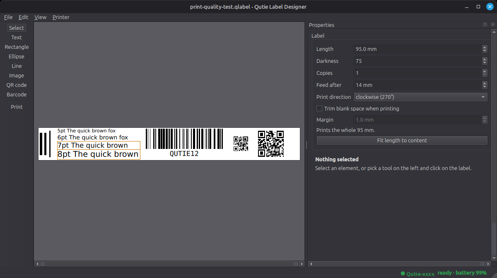

# qutie: Linux support for the PRT Qutie label printer

The PRT Qutie (HPRT "Q2" family) is a small Bluetooth thermal label printer that only comes with Android and iOS
apps (HerePrint / Sorticker). Its USB port is charge-only and no Linux driver exists. This project recovers how
the printer talks and provides:

- a **label designer** (Qt) to lay out and print labels, with live printer status,
- a **CUPS backend, filter and PPD** so any Linux application can print to it,
- a **command line tool** and a small **Python library**,
- a full **protocol description** ([docs/protocol.md](docs/protocol.md)) for anyone who wants to write their own.

*The designer with a print-quality test label. The status bar (bottom right) shows the printer is ready, with its
battery level; the printer name is redacted here.*

## Status

Developed and tested against one Qutie (firmware 1.1.22) with continuous 12 mm tape, on Linux Mint 22 with
BlueZ 5.72, CUPS 2.4 and Python 3.12. Printing, status reporting, error handling and print quality were checked
on the real printer (details in [docs/designer.md](docs/designer.md) and [docs/protocol.md](docs/protocol.md)).

Not tested: gap/die-cut label stock (the code for it exists but was never run), other HPRT models, other
Bluetooth stacks, macOS and Windows. The protocol layer is plain Bluetooth Classic RFCOMM (Linux `AF_BLUETOOTH`
sockets), so it is Linux-only as written.

## Install

    python3 -m venv .venv
    .venv/bin/pip install -e '.[gui]'      # '.' alone gives the CLI/CUPS parts without Qt

You need a working Bluetooth adapter that is switched on (`rfkill unblock bluetooth`, `bluetoothctl power on`).
No pairing is required. `liblzo2` (system library) is optional: without it a larger but valid uncompressed-LZO
stream is sent.

## Label designer

    .venv/bin/qutie-designer [label.qlabel]

- Text (any installed font), rectangles, ellipses, lines, images, QR codes and barcodes (Code 128, Code 39,
  EAN-13); move, resize, rotate, align, z-order, full undo/redo.
- "As printed" preview that is pixel-exact: the editor, the preview and the printout share one renderer.
- **Saves tape:** blank space before and after the content is trimmed when printing, and "Fit length to
  content" sets the label length for you.
- **Printer status in the status bar** (ready / battery / cover open / not reachable), refreshed while the window is
  active; printing is refused with a clear reason if the printer cannot print, and an unreachable printer
  offers a rescan.
- Warns about QR codes too small to scan and text that does not fit its box; refuses invalid barcode data.
- Self-contained `.qlabel` files (JSON, images embedded). `examples/` has two test labels: print
  `orientation-test.qlabel` first to check which way a label comes out.

Details, file format and rendering rules: [docs/designer.md](docs/designer.md).

## Command line

    qutie scan                         # find the printer (its name starts with "Qutie")
    export QUTIE_MAC=<address>         # or pass --mac every time
    qutie status                       # battery, auto-off, cover/paper/temperature conditions
    qutie info                         # model, firmware
    qutie print label.png              # 96 dots (12 mm) across at 203 dpi
    qutie print wide.png --rotate 270 --copies 2 --density 90

Images wider than the head are scaled down, narrower ones are centred; `--rotate` turns landscape artwork.

## CUPS: print from any application

    sudo cups/install.sh AA:BB:CC:DD:EE:FF      # installs backend, filter, PPD; creates the queue "Qutie"
    lp -d Qutie -o PageSize=12x40mm -o fit-to-page label.png
    lpoptions -p Qutie -l                       # QutieDensity, QutieMedia (Continuous|Gap), QutieFeed, sizes
    sudo cups/uninstall.sh Qutie                # remove again

The filter (`rastertoqutie`) converts CUPS raster to the printer's command stream; the backend (device URI
`qutie://AA-BB-CC-DD-EE-FF`) connects over Bluetooth, performs the handshake and obfuscates the stream.
`lpinfo -v` lists a switched-on printer found by a short scan. Page sizes are 12 mm wide (the print head).

Before sending a job the backend reads the printer status. With the cover open, no paper, or the printer too hot
or cold nothing is sent: the job stays queued with the reason as its status (for example "Paper cover is open")
and CUPS retries it about every five minutes. A switched-off or unreachable printer is retried the same way. After
the job the status is read again and a problem is logged as a warning. If the status cannot be read, the job is
printed anyway.

## Troubleshooting

| Symptom | Likely cause |
|---|---|
| `Host is down` / "Cannot reach the printer" | Printer is off (long-press the power button), out of range, or connected to another device such as the phone app. It talks to one device at a time. |
| Scan finds nothing right after switching on | It can take a few seconds to become discoverable; scan again. A second scan started during a running one is refused by BlueZ. |
| Connection reset right after a job | Reconnecting within about a second of closing a session can fail; the tools retry. |
| Text comes out upside down along the tape | Switch the label's "Print direction" (270 or 90 degrees). 270 was correct on the tested printer. |

## How it works

Bluetooth Classic SPP on RFCOMM channel 1, no pairing. After a small handshake every byte sent to the printer is
XORed with a session key; the printer answers status and info queries and accepts LZO-compressed 1-bit raster
blocks (`GS v 0` family). The whole story, with confidence levels (verified on hardware, taken from the app, or
inferred), is in [docs/protocol.md](docs/protocol.md).

## Development

    .venv/bin/pip install -e '.[test]' && .venv/bin/pytest

The test suite (about 180 tests) runs without a printer or a display (Qt uses the offscreen platform) and keeps
its Qt settings in a temporary directory. Code layout and working notes are in [CLAUDE.md](CLAUDE.md).

## Disclaimer and licence

This is an independent project, not affiliated with or endorsed by HPRT or PRT. "HPRT", "PRT", "HerePrint" and
"Sorticker" are names of their respective owners. The protocol was worked out for interoperability by observing
the printer and analysing the vendor's Android app; the repository contains no vendor code or assets, only
original code and notes. Use at your own risk: it sends commands to a real device.

Released under the [MIT licence](LICENSE).
